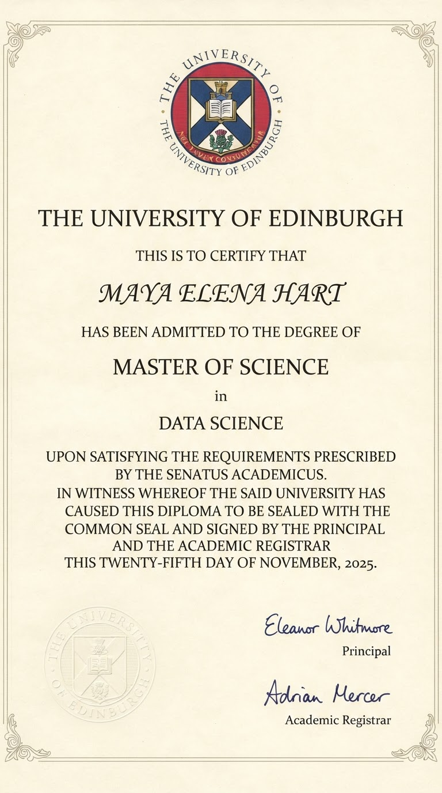
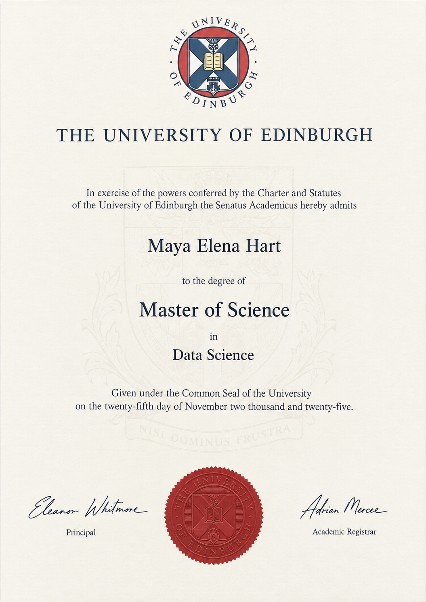
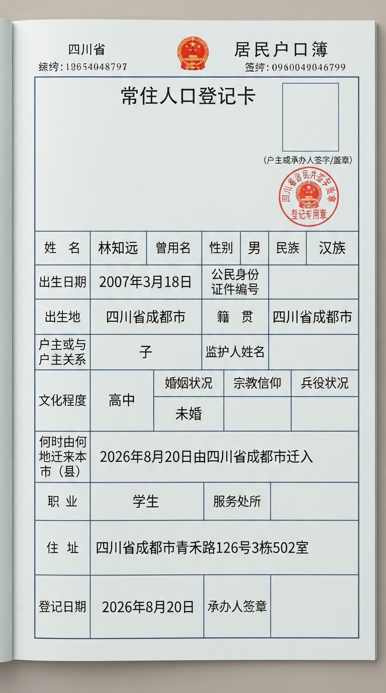
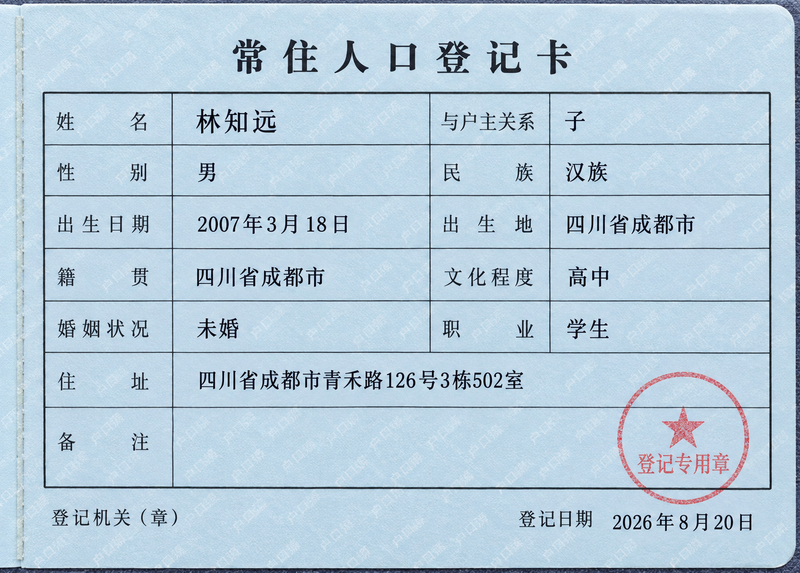

# 证件类提示词：分类与生图说明

本次提供1430个具体类别、4290条完整提示词，覆盖5个一级分类和40个二级分类。每个类别提供3种成像方式。

配套CSV：`证件类提示词_4290条.csv`。CSV包含完整提示词，可直接用于后续分配和生成。

## 一、分类

分类同时覆盖国内、国外和国际体系。类别按文书用途和对象划分，部分具有明确地区差异的文书保留地区属性。下表概括一级范围，完整二级目录见文末。

| 一级分类 | 二级分类数 | 具体类别数 | 提示词数 | 主要覆盖 |
| --- | ---: | ---: | ---: | --- |
| 身份与出入境 | 5 | 310 | 930 | 身份证明、户籍与居住登记、护照、居留与通行许可、签证及旅行授权 |
| 教育与荣誉 | 11 | 396 | 1188 | 校园卡、录取通知、学位与毕业证书、各类竞赛获奖和学业荣誉 |
| 资格与技能 | 9 | 296 | 888 | 财会金融、法律、教师语言、医疗、工程、计算机、运输与职业技能资格 |
| 经营与机构许可 | 8 | 240 | 720 | 企业登记、食品餐饮、医疗教育、建筑运输、环境安全及专项许可 |
| 民事、社保与财产 | 7 | 188 | 564 | 婚姻家庭、出生死亡、社保福利、不动产与机动车登记、民事公证 |
| **合计** | **40** | **1430** | **4290** | |

地域覆盖为：国内508类、国外国家830类、国际体系92类，对应1524、2490、276条提示词。各类根据文书实际用途设置覆盖范围，不要求中外数量对半。具体类别名称、国家或地区等信息保存在CSV的extra_json中。

---

## 二、提示词与成像安排

提示词明确文书类型、机构或地区及完整虚构取值，由模型运用已有知识组织该类文书的样式。给定姓名、机构、日期、资格、地址等信息保持原有写法；类别名和数据说明不要求逐项印在图面上。

| 文书载体 | 类别数 | 成像方式 | 提示词数 |
| --- | ---: | --- | ---: |
| 实体文书 | 1418 | 扫描、正拍、斜拍 | 4254 |
| 电子文书 | 12 | 原生页面、屏幕正拍、屏幕斜拍 | 36 |
| **合计** | **1430** | | **4290** |

扫描要求平面、均匀照明和完整证面；正拍允许简洁承托背景与自然光影；斜拍允许适度透视，主要信息保持可读。电子文书区分直接页面和屏幕拍摄，屏拍保留电子页面属性。

印章按类别处理：546类明确要求有章，578类不强制加章，306类由模型根据所选文书样式判断，该有章时必须呈现。章形、颜色、章文和位置由模型决定，不要求精确复刻真实印章；校徽、机构标志或红色标识不能代替可辨认的章印。同类三条采用相同印章要求，但不锁定同一枚章或相同位置。

同类三条属于同一核心信息组：给定取值相同，版式、固定印刷文案和装饰允许不同。它们不作为同一证面的严格三视图。输出画布按各条提示词采用3:2或2:3（宽:高），分别为2637条和1653条；文档本体的横竖方向与比例由相应样式决定，不拉伸文档填满画布。

---

## 三、生图效果

目前已有四类文书在nano banana 2 lite和chatgpt image 2.5 sunburst上的代表小样。以下8张按类别并列。

### 1. 爱丁堡大学学位证书

| nano banana 2 lite | chatgpt image 2.5 sunburst |
| --- | --- |
|  |  |

### 2. 四川常住人口登记卡

| nano banana 2 lite | chatgpt image 2.5 sunburst |
| --- | --- |
|  |  |

### 3. 香港商业登记证

| nano banana 2 lite | chatgpt image 2.5 sunburst |
| --- | --- |
|  |  |

### 4. CFP数字认证证书

| nano banana 2 lite | chatgpt image 2.5 sunburst |
| --- | --- |
|  |  |

---

## 四、CSV使用说明

CSV采用UTF-8 BOM，固定12列，全部为clean。每行是一条完整提示词，建议按以下字段使用：

| 字段 | 用途 |
| --- | --- |
| sample_id | 唯一样本编号，生成与记录时保留，用于关联图片、模型和验收结果 |
| category_l1 | 一级分类，用于筛选与安排覆盖 |
| category_l2 | 按“原二级分类 / 具体类别 / 成像方式”显示，例如“学位证书 / 爱丁堡大学—学位证书 / 扫描件” |
| prompt | 直接提交的完整提示词，不需要再拼接其他版本 |
| aspect_ratio | 输出画布宽高比：3:2或2:3（宽:高），与该条提示词中的要求一致 |
| target_texts | 给定核心取值的文字目标，不是整页OCR转录，也不预设最终阅读顺序 |
| extra_json | 保留原二级分类category_l2、具体类别、国家或地区、成像模式和核心信息组等信息；统计40个二级分类时读取其中的category_l2，或取展示路径第一段 |

同类三成像通过extra_json中的content_group_id或core_value_group_id关联。

## 附：40个二级分类

下表为当前1430类范围的二级明细。每个具体类别提供3条提示词。

| 一级分类 | 二级分类 | 具体类别数 | 提示词数 |
| --- | --- | ---: | ---: |
| 身份与出入境 | 身份证与身份证明卡 | 82 | 246 |
| 身份与出入境 | 户籍与居住登记 | 31 | 93 |
| 身份与出入境 | 护照与旅行证件 | 67 | 201 |
| 身份与出入境 | 通行、居留与学习工作许可 | 50 | 150 |
| 身份与出入境 | 签证与入境旅行授权 | 80 | 240 |
| 教育与荣誉 | 学生证与校园卡 | 92 | 276 |
| 教育与荣誉 | 录取通知与正式录取信 | 92 | 276 |
| 教育与荣誉 | 学位证书 | 92 | 276 |
| 教育与荣誉 | 独立毕业证书 | 10 | 30 |
| 教育与荣誉 | 数学统计与建模获奖证明 | 22 | 66 |
| 教育与荣誉 | 信息学编程与安全竞赛获奖证明 | 18 | 54 |
| 教育与荣誉 | 科学工程与创新竞赛获奖证明 | 28 | 84 |
| 教育与荣誉 | 艺术设计与语言竞赛获奖证明 | 12 | 36 |
| 教育与荣誉 | 体育获奖与运动荣誉证明 | 9 | 27 |
| 教育与荣誉 | 学业表彰奖学金与综合荣誉 | 19 | 57 |
| 教育与荣誉 | 法律商科与社会科学竞赛获奖证明 | 2 | 6 |
| 资格与技能 | 财会金融税务与风险资格 | 25 | 75 |
| 资格与技能 | 法律与其他专业执业资格 | 16 | 48 |
| 资格与技能 | 教师教学与语言能力资格 | 31 | 93 |
| 资格与技能 | 医疗护理与卫生专业资格 | 30 | 90 |
| 资格与技能 | 工程建筑与项目管理资格 | 40 | 120 |
| 资格与技能 | 计算机云平台与信息安全认证 | 47 | 141 |
| 资格与技能 | 工业技术与设备操作资格 | 30 | 90 |
| 资格与技能 | 驾驶航空航海与运输资格 | 46 | 138 |
| 资格与技能 | 生活服务、社会工作与其他职业技能 | 31 | 93 |
| 经营与机构许可 | 企业与组织登记证件 | 71 | 213 |
| 经营与机构许可 | 食品餐饮与商业经营许可 | 29 | 87 |
| 经营与机构许可 | 医疗药品与健康机构许可 | 22 | 66 |
| 经营与机构许可 | 教育培训与托育机构许可 | 15 | 45 |
| 经营与机构许可 | 建筑施工、工程资质与项目许可 | 18 | 54 |
| 经营与机构许可 | 交通运输物流与仓储许可 | 23 | 69 |
| 经营与机构许可 | 环境生产与安全许可 | 28 | 84 |
| 经营与机构许可 | 文化旅游传媒与其他专项许可 | 34 | 102 |
| 民事、社保与财产 | 婚姻与家庭关系证明 | 34 | 102 |
| 民事、社保与财产 | 出生死亡与民事登记证明 | 27 | 81 |
| 民事、社保与财产 | 社保与医疗保障身份凭证 | 36 | 108 |
| 民事、社保与财产 | 退休福利与待遇资格证明 | 24 | 72 |
| 民事、社保与财产 | 不动产土地与房屋权属 | 32 | 96 |
| 民事、社保与财产 | 机动车与其他财产登记 | 31 | 93 |
| 民事、社保与财产 | 民事公证与其他证明 | 4 | 12 |
| **合计** | **40个二级分类** | **1430** | **4290** |

当前公开文件入口：[GitHub：印章要求修订交付版](https://github.com/dev230817-blip/credential_prompts_3000/tree/main/deliveries/20261021_seal_v1)。查看图文说明时请保留本文件与images文件夹的相对位置。
